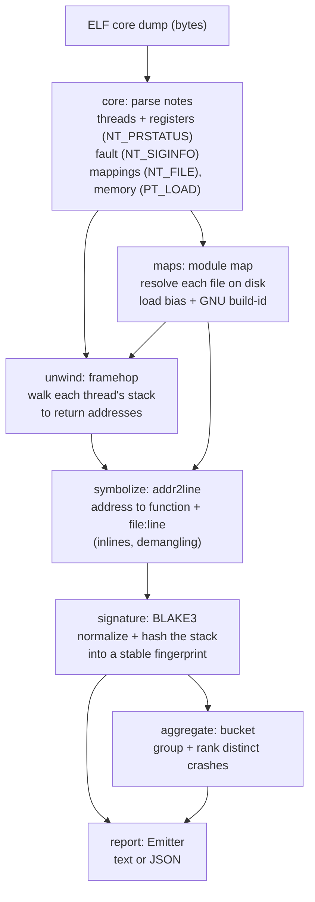

# coretriage architecture

This explains how coretriage turns a raw core dump into a symbolicated, deduplicated crash
report, and defines the concepts involved. It is aimed at readers new to core dumps and DWARF.

## The pipeline

A core dump goes through a fixed set of stages, each a module in `coretriage-core`. The data
model in `model` is the contract between them; everything is computed from the core bytes plus
the on-disk binaries you point at.



The entry points are `triage` (one core) and `triage_batch` (a directory, in parallel), plus
`triage_bytes`, which takes the core's bytes directly instead of a file path. `triage_batch` runs the same per-core pipeline, then
groups the results by signature.

## The address model

This is the part that confuses people. There are two kinds of address:

- **svma (stated virtual memory address)**: the address a symbol has *in the ELF file on
  disk*, as the linker laid it out. DWARF and the symbol table are expressed in svma.
- **avma (actual virtual memory address)**: the address a symbol has *in the running process*,
  as captured in the core. Stacks and registers are in avma.

For a position-independent executable (PIE) or a shared object, the loader places the module at
some base address, so the two differ by a constant:

```
load_bias = avma - svma        (the shift the loader applied)
```

So the flow is: unwinding yields **avma** return addresses from the core; to look a frame up in
the DWARF you convert it back to **svma** with `svma = avma - load_bias`; and to attribute a
frame to a module you check which module's avma range contains it. coretriage reads each
module's load address from the core's `NT_FILE` mappings and its lowest stated address from the
on-disk ELF, and the difference is the load bias.

One subtlety: a *return* address points to the instruction *after* a call, which may be on the
next source line. Lookups use `address - 1` so a frame resolves to the call site, matching what
a debugger shows.

## Anatomy of a core dump

A Linux core is just an ELF file of type `ET_CORE`. It has no sections, only **program
headers** of two kinds:

- **`PT_LOAD`**: a snapshot of a region of process memory (stack, heap, writable data, and the
  in-memory copies of the loaded ELF headers). coretriage reads memory by virtual address by
  finding the `PT_LOAD` that covers it. Only memory the kernel saved is present.
- **`PT_NOTE`**: metadata records. The ones coretriage reads:
  - **`NT_PRSTATUS`**: one per thread - its id (`pr_pid`), the signal that stopped it
    (`pr_cursig`), and its register set (`pr_reg`, including `rip`/`rsp`/`rbp`). The crashing
    thread comes first.
  - **`NT_SIGINFO`**: the `siginfo_t` for the crashing thread, including the faulting address
    (`si_addr`) for memory faults.
  - **`NT_FILE`**: the file-backed mapping table - which file is mapped where, used to build the
    module map.

A hang core (taken with `gcore` from a live process) has the same shape but no fatal signal, so
`pr_cursig` is 0; coretriage reports that as a `Hang`.

## Symbolication: what you need, and when it is partial

To turn an address into `module!function (file:line)` you need the **matching binary** (same
GNU build-id) and, for `file:line`, its **DWARF** debug info.

- **Build-id** is a content hash the linker stamps into every ELF (`.note.gnu.build-id`). It
  appears in the binary, in any split `.debug` file, and in the core's saved ELF headers, so it
  is the key that ties them together. Because it is derived from the binary's contents, any
  change that alters the binary (a source edit, different flags) yields a new build-id, while a
  byte-identical build yields the same one. coretriage checks it and warns on a mismatch.
- **Stripped binary** (no DWARF): you still get function names from the ELF symbol table
  (nearest-symbol fallback), but no source lines. Fully stripped: only raw addresses.
- **Statically linked binary**: everything, including libc, is in one file, so the whole
  backtrace resolves from that single binary with no gaps.
- **Dynamically linked, missing a library** (e.g. libc not present on the triage host): frames
  in that library show as `libc.so.6!<unknown>`. This is expected; ship or fetch the library
  (by build-id) to resolve them.

## The signature

The signature is a **stable fingerprint of a crash**, used to dedup and track crashes over
time. It is a BLAKE3 hash of the crashing thread's top frames, normalized to `module!function`
with runtime-noise frames (libc/startup glue) dropped, and deliberately **excluding addresses
and line numbers** - so the same bug hashes the same across different builds, machines, and
ASLR, and a one-line code move does not create a "new" crash. For a hang it is the hash of the
sorted set of each thread's stall site, so thread ordering does not matter.

## Glossary

- **core dump**: an `ET_CORE` ELF file - a snapshot of a process's memory and thread state at
  the moment it crashed or was captured.
- **thread / frame**: a thread has a backtrace of frames; `#0` is innermost (the crash site),
  higher numbers are its callers out to `main`.
- **fault**: what took the process down - a fatal `signal` (with a number and, for memory
  faults, an address) or a `hang` (no signal).
- **module**: a loaded ELF file - the executable or a shared object mapped into the process
  (not a source file or a Rust `mod`).
- **svma / avma / load bias**: on-disk address / in-process address / the shift between them
  (see above).
- **unwinding**: reconstructing the chain of return addresses from register + stack state,
  using DWARF call-frame info (`.eh_frame`) or frame pointers. coretriage uses `framehop`.
- **symbolication**: mapping an address to a function name and source location via DWARF or the
  symbol table. coretriage uses `addr2line`.
- **build-id**: the linker-stamped content hash that identifies a binary and matches it to its
  debug info and cores.
- **signature / bucket**: a crash's stable hash / a group of cores that share one signature.
